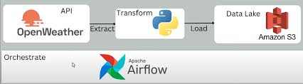
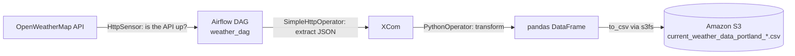

# Weather ETL Pipeline — Apache Airflow → Amazon S3

A daily Apache Airflow DAG that pulls current weather for Portland from the OpenWeatherMap API, converts it into a clean tabular record, and lands it in Amazon S3 as a timestamped CSV.



## Architecture



## Tech stack

- **Orchestration:** Apache Airflow (`HttpSensor`, `SimpleHttpOperator`, `PythonOperator`)
- **Language:** Python, pandas
- **Source:** OpenWeatherMap Current Weather API
- **Storage:** Amazon S3

## What it demonstrates

- A three-task DAG with a sensor gate: `is_weather_api_ready >> extract_weather_data >> transform_load_weather_data`
- Passing API responses between tasks with XCom
- Transformations: Kelvin → Fahrenheit for temperature / feels-like / min / max, and converting Unix timestamps (record time, sunrise, sunset) to local time using the API's timezone offset
- Writing the result straight to S3 with a timestamped key
- Retry policy (`retries=2`, `retry_delay=2 min`), `@daily` schedule, `catchup=False`

## Project structure

```
.
├── weather_dag.py   # the Airflow DAG (extract → transform → load)
└── image.jpeg       # architecture diagram
```

## How to run

1. Install Airflow and the dependencies (inside a virtual environment):
   ```bash
   pip install apache-airflow apache-airflow-providers-http pandas s3fs
   ```
2. Copy `weather_dag.py` into your Airflow `dags/` folder and start Airflow (`airflow standalone` for local testing).
3. In the Airflow UI:
   - **Admin → Connections:** add an HTTP connection `weathermap_api` with host `https://api.openweathermap.org`.
   - **Admin → Variables:** add `openweather_api_key` with your OpenWeatherMap API key. The key is never stored in code.
4. Change the S3 bucket name in `transform_load_data` to one you own, and provide AWS credentials. An IAM role on the Airflow host is the safest option; otherwise use environment variables. Don't hard-code them.
5. Trigger `weather_dag` from the UI.

## Possible next steps

- Read AWS credentials from an Airflow connection or IAM role instead of the `storage_options` placeholder dict
- Parameterise the city list and fan out one task per city
- Load the CSVs into a warehouse (Redshift / Snowflake / Athena table) for analysis
- Add data-quality checks on the API response before writing
